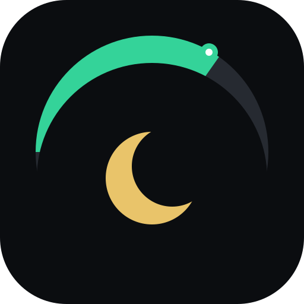
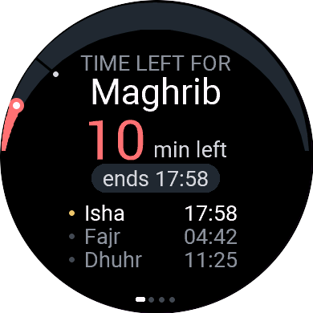
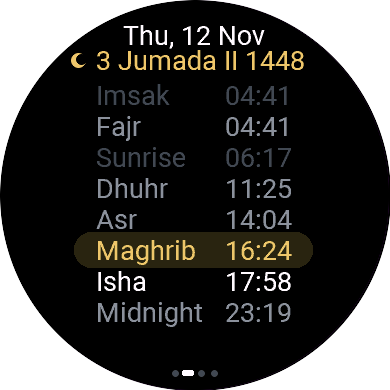
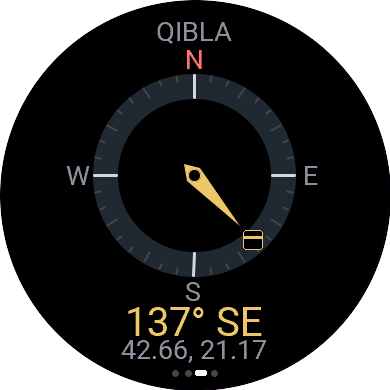
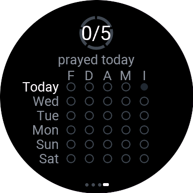

# Qibla and Salah: prayer times and reminders for Garmin watches

A free, open-source Connect IQ app that calculates the five daily prayer times
**on the watch** (no phone, no internet) and buzzes you **before a prayer's time
runs out** — "Asr ends in 20 min · prayed?" — unless you've already marked it prayed.

<p align="center"></p>

<p align="center">




</p>

**Connect IQ Store:** https://apps.garmin.com/apps/168b7832-789e-4c8a-bf38-f791dda716e9 (in review)

## Features

- **Now** — a crescent across the top of the screen shows how much of the current
  prayer's time is left (green → amber → red as the warning approaches, with a notch
  at the warning time), a big countdown, and the next three prayers.
  Tap / press select to mark the prayer as prayed.
- **Today** — every time from Imsak to Islamic midnight, with the Hijri date.
- **Qibla** — compass needle to the Kaaba (turns green and buzzes when you face it).
- **Week** — which prayers you marked over the last six days, and your streak.
- **Glance** — current prayer, time left and a progress bar in the widget loop.
- **Reminders** — per-prayer warning N minutes before the time ends (0 = off), and an
  optional alert when each time starts. On watches with Connect IQ 5.1+ these are real
  notifications with **Prayed / Not yet** buttons ("Not yet" reminds you again in 5
  minutes); older watches get a vibrating "open the app?" prompt.
- **Settings on the watch** (hold the lower button / menu) and in the Garmin Connect app:
  warning times, location (watch GPS, a GPS fix, or ~110 cities), calculation method,
  Asr school, Isha end, high-latitude rule, Hijri date adjustment, extra minutes.
- **Languages**: English, Arabic, Bosnian/Croatian, Dutch, French, German, Indonesian,
  Malay, Russian, Turkish.

## Prayer windows

| Prayer  | Time ends at                                   |
|---------|------------------------------------------------|
| Fajr    | Sunrise                                        |
| Dhuhr   | Asr                                            |
| Asr     | Maghrib                                        |
| Maghrib | Isha                                           |
| Isha    | Islamic midnight (or Fajr — setting)           |

## Calculation

`source/PrayerCalc.mc` implements the praytimes.org algorithm in double precision.
**By default the method is chosen from your location** (`Prayers.REGIONS`), e.g.:

| Region | Method |
|---|---|
| Kosovo | Kosovo (BIK takvim) — see below |
| Turkey, Balkans | Diyanet |
| North America | ISNA |
| Saudi Arabia, Yemen | Umm al-Qura (Isha 120 min after Maghrib in Ramadan) |
| UAE / Qatar / Kuwait / Bahrain, Oman | Dubai / Qatar / Kuwait / Gulf |
| Egypt, Sudan, Libya, Levant | Egyptian Authority |
| Jordan · Morocco · Algeria · Tunisia · Portugal | their national methods |
| Pakistan, India, Bangladesh, Afghanistan | Karachi, Hanafi Asr |
| Iran | Tehran (Jafari midnight) |
| Malaysia/Brunei · Indonesia · Singapore | JAKIM · Kemenag · MUIS |
| Russia, Central Asia | Spiritual Administration of Russia (Hanafi Asr in Central Asia) |
| Everywhere else | Muslim World League |

Also available: Karachi, Shia Ithna-Ashari (Qum), France (UOIF). Any method can be chosen
manually; "extra minutes" are added on top of the method's own offsets.

**Kosovo (BIK takvim).** The official takvim of the Islamic Community of Kosovo applies
seasonal adjustments no standard method reproduces. The app models each time as an
astronomical time (Fajr 18.5°, Isha 15.25°) plus a smooth yearly correction fitted to
32 days of the takvim (2023–2026): 81 of 192 values exact, 93 within 1 min, the rest
within 2–3 min — the takvim itself varies by about a minute between years. Its Hijri
date follows Umm al-Qura (29 of the 32 archived days match; the rest are month starts
the Islamic Community announces itself, e.g. Ramadan 1447 began a day later), so no
fixed shift is applied; use the ±2 day Hijri adjustment around those dates.
Re-fit: `tools/fetch_takvim.py` then `tools/fit_takvim.py`.

**High latitudes.** Fajr/Isha use the angle-based rule by default (middle-of-night and
one-seventh are available); if Isha would start at/after Islamic midnight its window
runs to Fajr. Beyond 66° (polar day/night) the times of latitude 45° on the same
meridian are used, per the Islamic Fiqh Council (Muslim World League) resolution.

**Hijri date.** Umm al-Qura table for 1446–1458 AH (`tools/gen_hijri.py`), adjustable ±2 days.

The timezone comes from the watch clock, so daylight-saving changes are automatic.

## Accuracy & tests

All tests run in the Connect IQ simulator (`source-test/`, compiled only into the
`--unit-test` build — never into the app):

- **Every method against api.aladhan.com** at a city where it is used, on 8 dates
  across the year (1,584 values): all within 1 min, except Asr within 2 min at high
  latitudes — checked against a precise NOAA-based solar calculation our Asr is within
  0.4 min there, aladhan's is up to ~3 min off.
- **Kosovo method** against the fitted reference, and **Diyanet** with the original tune.
- **Property tests** (seeded random places/dates/methods, thousands of cases):
  prayers are in order; Dhuhr is solar noon; a timezone shift moves every time by
  exactly 60 min; moving 15° with the clock changes nothing; extra minutes add exactly;
  Hanafi Asr is later; fixed-minute rules hold; both midnight rules; deeper twilight
  angles give earlier Fajr / later Isha; day length (equator, equinoxes, seasons);
  the polar rule (beyond 66° = 45°); Qibla range, due north/south on the Kaaba's meridian, *walking 10 km
  along the Qibla gets you 10 km closer*, known cities; compass labels; every day of
  the Hijri table advances by one with 29/30-day months; region lookup.

```sh
monkeyc -f monkey.jungle -d vivoactive5 -y <developer_key.der> -o bin/test.prg --unit-test
monkeydo bin/test.prg vivoactive5 -t
```

## Supported watches

133 watches (Connect IQ 2.4 and later), at three levels:

- **Full** — AMOLED/LCD and 64-colour MIP watches: Venu, vívoactive 3–6, Forerunner
  165–970, fenix 5–9, epix, Enduro, MARQ, Descent, D2, Approach S50/S6x/S7x, Instinct 3
  AMOLED / Crossover AMOLED, Venu Sq / X1 …
- **Black-and-white & 16-colour screens** — Instinct 2/2S/2X/Crossover, Instinct 3 Solar,
  Instinct E, Descent G1, Forerunner 55/735XT: a high-contrast monochrome / low-colour theme.
- **Older watches** — real notifications need Connect IQ 5.1+ (others get a prompt);
  the on-watch settings menu needs 3.0+ (on 2.4 watches use the Garmin Connect app).

The background reminder service is kept under the 32 KB limit of older watches (it
works with plain numbers and text tables; see the comments in `Prayers.mc`).

Not supported: fenix 3, Forerunner 230/235/630/920XT, vívoactive (2015), D2 Bravo,
Epix (2015) — Connect IQ 1.x has no background service or storage. Bike computers and
handheld GPS units are not targeted.

## Build

Requires the Connect IQ SDK, JDK 17 and a developer key
(`openssl genrsa -out key.pem 4096 && openssl pkcs8 -topk8 -inform PEM -outform DER -in key.pem -out key.der -nocrypt`).

```sh
python3 tools/gen_jungle.py                       # per-watch theme/feature selection
monkeyc -f monkey.jungle -d vivoactive5 -y key.der -o bin/Namaz.prg   # one watch
monkeyc -e -r -f monkey.jungle -y key.der -o bin/Namaz.iq             # store package
```

Sideload: copy `bin/Namaz.prg` to `GARMIN/APPS/` over USB (`tools/install-watch.sh`).

### Simulator on NixOS

The simulator needs webkitgtk-4.0, which current nixpkgs dropped; an FHS environment
from nixos-24.05 works, see `tools/nixos-sim.nix`. Run it on a hidden Xvfb display so it
never takes focus.

## CI

`.github/workflows/ci.yml` runs the Python reference tests on every push and pull
request. The watch job (SDK + device download, simulator tests, store package) needs a
Garmin login; its secrets live only in the `garmin` environment, which only `main` can
use, and the job never runs for pull requests. Actions are pinned to commits and the
downloaded SDK manager is checksum-verified; the cache never contains the login token.

## Privacy

Nothing leaves the watch. Location is only used on the watch to calculate times;
the app has no network access.

## Contributing

Corrections to methods, regions and translations are very welcome — especially from
native speakers (translations were machine-assisted). Please run the tests before a PR.

## License

MIT — see [LICENSE](LICENSE).
